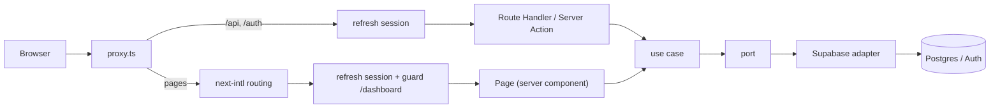

# Verba

> Words That Work.

Verba is a web app for practising English writing. You pick a prompt, write in English and get your text back corrected, with the reason for every mistake. The interface is bilingual (Vietnamese by default, English available) and sign-in uses Google (or email and password).

This repository is also a reference for a **spec-driven, test-driven, clean-architecture** Next.js codebase: every feature starts as a spec with numbered acceptance criteria, every criterion is traced to a test, and the layer boundaries are enforced by lint.

## Contents

- [What is in the project](#what-is-in-the-project)
- [Tech stack](#tech-stack)
- [Quick start](#quick-start)
- [Environment variables](#environment-variables)
- [Scripts](#scripts)
- [Architecture](#architecture)
- [Project structure](#project-structure)
- [Request flow](#request-flow)
- [Authentication](#authentication)
- [Database](#database)
- [Internationalization](#internationalization)
- [UI and design](#ui-and-design)
- [Testing and quality gates](#testing-and-quality-gates)
- [Spec-driven workflow](#spec-driven-workflow)
- [Working with Claude Code](#working-with-claude-code)
- [Deployment](#deployment)
- [Troubleshooting](#troubleshooting)
- [Conventions](#conventions)

## What is in the project

| Area | What exists today |
| --- | --- |
| Landing page | Hero with an animated "teacher's red pen" correction demo, how it works, features, call to action, footer |
| Sign-in and sign-up | Google (OAuth, PKCE); email + password with a sign-in/sign-up tab form, per-field translated errors, password rules, show/hide password, email confirmation with resend; callback route, sign-out, session refresh |
| Account menu | Avatar, name and email in the navbar, menu with "Go to dashboard" and "Sign out" |
| Dashboard | Protected page showing the signed-in user's profile |
| Languages | Vietnamese (`/`) and English (`/en`), language switcher, choice remembered in a cookie |
| API | `GET /api/health`, `GET /api/hello`, `GET /api/me` (Route Handlers) |
| Database | `profiles` table with row level security, auto-created on sign-up (also from Google) |
| Quality | Vitest tests, coverage thresholds, spec-to-test traceability check, layer rules in ESLint |

The writing practice features themselves (prompts, corrections) are the next specs to be written; the foundation around them (auth, profile, i18n, landing) is in place.

## Tech stack

- **Framework:** Next.js 16 (App Router, Turbopack, Cache Components, `proxy.ts`), React 19
- **Language:** TypeScript (strict)
- **Styling:** Tailwind CSS v4 (CSS-first config in `globals.css`), shadcn/ui (new-york style, Radix primitives), lucide-react icons
- **Fonts:** Be Vietnam Pro (text) and Caveat (handwriting), self-hosted through Fontsource
- **Backend:** Next.js Route Handlers and Server Actions
- **Database and auth:** Supabase (PostgreSQL, Auth) through `@supabase/ssr`
- **i18n:** next-intl
- **Validation:** zod 4
- **Tests:** Vitest 5 with `@vitest/coverage-v8`

## Quick start

### Prerequisites

- Node.js 20.9 or newer (22 LTS recommended) and npm
- A free [Supabase](https://supabase.com) project
- (Optional, for Google sign-in) a Google Cloud project

### 1. Install

```bash
npm install
```

### 2. Configure environment variables

```bash
cp .env.example .env.local   # on Windows: copy .env.example .env.local
```

Fill in the values (see [Environment variables](#environment-variables)). In the Supabase dashboard open **Connect** (or **Project Settings → API**) to find the project URL and the publishable key.

### 3. Create the database tables

Open the Supabase **SQL Editor** and run, in order:

1. `supabase/migrations/0001_profiles.sql`
2. `supabase/migrations/0002_profile_from_oauth.sql`

### 4. (Optional) Turn on Google sign-in

Follow [`docs/google-login-setup.md`](docs/google-login-setup.md) (email and password setup: [`docs/email-auth-setup.md`](docs/email-auth-setup.md)). It covers the Google Cloud OAuth client, the callback URL, the Supabase provider settings and the redirect URLs for local and production.

### 5. Run

```bash
npm run dev
```

Open <http://localhost:3000> (Vietnamese) or <http://localhost:3000/en> (English).

### 6. Check that everything is healthy

```bash
npm run check    # typecheck + lint + tests with coverage + spec traceability
npm run build    # production build
```

## Environment variables

| Variable | Scope | Required | Description |
| --- | --- | --- | --- |
| `NEXT_PUBLIC_SUPABASE_URL` | browser + server | yes | Supabase project URL |
| `NEXT_PUBLIC_SUPABASE_PUBLISHABLE_KEY` | browser + server | yes | Supabase publishable (anon) key |
| `NEXT_PUBLIC_SITE_URL` | browser + server | yes | Base URL of the app (`http://localhost:3000` locally, your domain in production). Used to build OAuth redirect URLs |
| `SUPABASE_SERVICE_ROLE_KEY` | **server only** | no | Only needed if you use `src/infrastructure/supabase/admin.ts`. Never prefix with `NEXT_PUBLIC_` |

Security rules:

- Never commit `.env*` files (only `.env.example`, with no real values).
- The Google Client Secret lives only in the Supabase dashboard, never in this repository.
- The service role key must stay on the server.

## Scripts

| Command | What it does |
| --- | --- |
| `npm run dev` | Start the dev server on port 3000 |
| `npm run build` / `npm start` | Production build / serve it |
| `npm run typecheck` | `tsc --noEmit` |
| `npm run lint` | ESLint, including the architecture boundary rules |
| `npm test` | Run all tests once |
| `npm run test:watch` | Watch mode |
| `npm run test:coverage` | Tests plus coverage thresholds (90% statements, lines, functions; 85% branches) |
| `npm run specs:check` | Fail if an acceptance criterion in `specs/` has no test carrying its code |
| `npm run check` | The full quality gate: typecheck, lint, coverage, specs |
| `npx shadcn@latest add <name>` | Add a shadcn/ui component |

## Architecture

The code follows **Clean Architecture**, split by feature module. Dependencies point only inward:

```
presentation (src/app)  →  application (use cases + ports)  →  domain (entities)
                                      ↑
                          infrastructure (implements the ports)
```

| Layer | Location | Knows about | Must not know about |
| --- | --- | --- | --- |
| Domain | `src/modules/<feature>/domain`, `src/core` | plain TypeScript only | everything else |
| Application | `src/modules/<feature>/application` | domain, zod, ports | Next.js, Supabase, infrastructure |
| Infrastructure | `src/modules/<feature>/infrastructure`, `src/infrastructure` | application ports, Supabase | presentation |
| Presentation | `src/app`, `src/components`, `src/lib/http.ts`, `src/lib/action-error.ts` | use cases through `getContainer()` | infrastructure classes |

Key ideas:

- **Use cases are functions** that take their dependencies as parameters, for example `signIn(auth, input)`. There are no singletons or globals, so they are trivial to test with fakes (`src/test/fakes.ts`).
- **Ports are interfaces** (`AuthService`, `ProfileRepository`). Supabase implements them (`SupabaseAuthService`, `SupabaseProfileRepository`). Swapping the database means writing new adapters, not touching use cases.
- **One composition root:** `src/server/container.ts` is the only file that wires ports to concrete classes. It is cached per request.
- **Typed errors:** use cases throw `AppError` subclasses (`ValidationError`, `UnauthorizedError`, `NotFoundError`, `InfrastructureError`). Route Handlers wrap with `handle(...)` and forms with `toActionError(...)`, which map errors to HTTP status codes or messages and never leak internals.
- **Input is `unknown`** at the edge and validated with `parseOrThrow(schema, input)` using zod.
- **Domain types are not database rows.** Mapping between rows and domain types lives in infrastructure.
- **Boundaries are enforced by ESLint** (`no-restricted-imports` in `eslint.config.mjs`), so a wrong import fails `npm run lint`.

## Project structure

```
.
├── messages/                    UI strings: vi.json, en.json (next-intl)
├── public/                      static assets
├── scripts/check-specs.mjs      AC → test traceability check
├── specs/                       specifications (written in Vietnamese)
│   ├── constitution.md          project principles
│   ├── _templates/              spec / plan / tasks templates
│   └── 000-core … 007-i18n/     one folder per feature
├── supabase/migrations/         numbered SQL migrations
├── docs/google-login-setup.md   Google sign-in dashboard guide
├── .claude/                     rules, skills and agents for Claude Code
└── src/
    ├── app/
    │   ├── [locale]/            localized pages (layout, home, login, dashboard)
    │   ├── api/                 Route Handlers (health, hello, me)
    │   ├── auth/                OAuth callback and sign-out routes (no locale prefix)
    │   ├── globals.css          Tailwind v4 theme, brand tokens, notebook/pen styles
    │   └── icon.svg             app icon
    ├── components/
    │   ├── landing/             landing sections, logo, navbar parts, user menu, language switcher
    │   └── ui/                  shadcn/ui primitives (button, card, input, avatar, dropdown-menu)
    ├── core/                    AppError classes, validation helper
    ├── i18n/                    routing, request config, navigation helpers, locale-path utils
    ├── infrastructure/supabase/ Supabase clients (browser, server, admin), env, session proxy
    ├── lib/                     presentation helpers (http, action-error, safe-redirect, site-url, display logic)
    ├── modules/
    │   ├── auth/                sign in, sign up, Google sign-in, session, sign out
    │   ├── profile/             read the current user's profile
    │   └── greeting/            minimal example module
    ├── server/container.ts      composition root
    ├── test/fakes.ts            in-memory fakes for ports
    └── proxy.ts                 Next.js 16 proxy: i18n routing + session refresh + route protection
```

Alias: `@/*` maps to `src/*`.

## Request flow



1. Every request goes through `src/proxy.ts`. Pages get locale handling from next-intl; `api` and `auth` routes skip it.
2. The proxy refreshes the Supabase session cookies and redirects guests away from `/dashboard` (to `/login` or `/en/login`).
3. Server components, Route Handlers and Server Actions call `getContainer()` and then a use case. They never touch Supabase directly.
4. Use cases validate input, apply the rules and call ports. Adapters talk to Supabase.

## Authentication

- **Google:** `loginWithGoogle` (Server Action) asks the use case for the provider URL (`signInWithOAuth`, PKCE) and redirects. Google returns to Supabase, which returns to `/auth/callback?code=...`. The callback exchanges the code for a session and redirects to `next` (default `/dashboard`).
- **Email and password:** `signIn`, `signUp` and `resendConfirmation` use cases (spec 008, setup in [`docs/email-auth-setup.md`](docs/email-auth-setup.md)).
  - Sign-up asks for full name, email, password and confirmation. Passwords must be 8-72 characters with a letter and a digit; sign-in only requires a non-empty password so older accounts keep working.
  - Email is trimmed and lower-cased. The full name is saved to `profiles.full_name`.
  - Failures are stable codes (`invalid_credentials`, `email_taken`, ...) that the form translates; raw Supabase messages are never shown, and a sign-up with an existing email looks like a new one when confirmation is on (no email enumeration).
  - With email confirmation on, the user sees a "Check your email" screen with a resend button.
- **Sign-out:** `POST /auth/signout`, then redirect to the login page.
- **Session refresh:** the proxy calls `getUser()` on every request, so tokens stay fresh. Server code always uses `getUser()`, never `getSession()`.
- **Open-redirect protection:** every `next` or redirect parameter goes through `safeNextPath()` (only same-site paths are accepted). The app base URL comes from `getSiteUrl()`, never a hard-coded host.
- **Avatars:** only `https` avatar URLs are rendered, with `referrerPolicy="no-referrer"`.

## Database

Schema lives in `supabase/migrations/` and is applied by hand in the Supabase SQL Editor (or with the Supabase CLI).

| Table | Purpose |
| --- | --- |
| `public.profiles` | One row per user: `id` (FK to `auth.users`), `full_name`, `avatar_url`, timestamps |

- Row level security is on; users can only read and change their own row.
- A trigger on `auth.users` creates the profile automatically on sign-up. Migration `0002` also copies the name and avatar from Google metadata.
- Rule: every table in `public` must have RLS enabled and policies.

To add a table, use the `/add-db-migration` skill or create the next numbered file (`0003_...sql`).

## Internationalization

- **Library:** next-intl. Locales: `vi` (default) and `en`, defined in `src/i18n/routing.ts`.
- **URLs:** Vietnamese has no prefix (`/`, `/login`, `/dashboard`); English uses `/en` (`/en`, `/en/login`, `/en/dashboard`). `api` and `auth` routes have no prefix.
- **Strings:** `messages/vi.json` and `messages/en.json`, grouped by namespace (`Hero`, `Login`, ...). No user-facing text is hard-coded in components.
- **Switching:** the language switcher keeps you on the same page; next-intl remembers the choice in the `NEXT_LOCALE` cookie. After sign-in or sign-out you stay in your language.
- **Tests:** a test checks that both files have exactly the same keys, no empty values and the same placeholders.
- **Add a language:** create `messages/<code>.json`, add the code to `locales` in `src/i18n/routing.ts`, add its label in the language switcher.
- Server-side error messages thrown by use cases are currently English only (tracked as an open question in `specs/007-i18n/spec.md`).

## UI and design

- **Concept:** a ruled school notebook. Lines, a red margin and a red pen that corrects a sentence, because the product is about being corrected.
- **Brand:** the logo is a black rounded square with "VERB" in white, next to the wordmark "Verba".
- **Motion:** one orchestrated moment, the red-pen correction in the hero demo. It respects `prefers-reduced-motion`.
- **Accessibility:** keyboard-friendly menus (Radix), visible focus rings, a skip link, semantic landmarks, screen-reader text for the corrections.
- **Responsive:** designed down to 390px wide.

## Testing and quality gates

- **TDD:** Red → Green → Refactor. No production code without a test that failed first for the right reason; bug fixes start with a reproducing test.
- **What is unit tested:** use cases (with fake ports), adapters (with a fake Supabase client), proxy session logic, the OAuth callback, helpers (`safe-redirect`, `site-url`, `http`, `action-error`), display logic and the message files.
- **What is checked by hand:** UI behaviour such as menus, responsive layout and real Google sign-in. These are acceptance criteria marked `manual` in the spec.
- **Coverage:** thresholds are 90/85/90/90 (statements/branches/functions/lines) over the logic layers listed in `vitest.config.ts`. UI and Next.js glue code are covered by manual criteria and the build.
- **Quality gate:** `npm run check` and `npm run build` must pass before work is considered done.
- **CI:** a GitHub Actions workflow is provided in `.github/workflows/ci.yml` that runs the same checks.

Do not lower thresholds, skip or delete tests to get green.

## Spec-driven workflow

The spec is the source of truth and tests are the evidence.

```
/spec → (approve) → /plan → (approve) → /tasks → /implement → /verify
```

- Each feature has `specs/NNN-name/spec.md` with goals, scope, requirements and **acceptance criteria** coded `PREFIX-AC-NN` in Given/When/Then form. Specs do not mention technology.
- Every criterion needs a test whose name contains the code, for example `it("AUTH-AC-02: ...")`, or an explicit `manual` mark. `npm run specs:check` enforces this.
- Behaviour changes start by editing the spec, then the tests, then the code.
- Specs are written in **Vietnamese**; everything else in the repository is English.
- Index of specs: [`specs/README.md`](specs/README.md). Principles: [`specs/constitution.md`](specs/constitution.md).

| Spec | Topic |
| --- | --- |
| 000 core | Errors, validation, HTTP and action helpers |
| 001 auth | Email and password sign-in |
| 002 profile | Current user's profile |
| 003 greeting | Minimal example module |
| 004 google-login | Google sign-in, callback, session refresh |
| 005 landing-page | Landing page and login screen |
| 006 navbar-profile | Name, email, avatar and account menu in the navbar |
| 007 i18n | Vietnamese and English |
| 008 email-auth | Sign-up and sign-in with email and password |

## Working with Claude Code

The `.claude/` folder configures Claude Code for this repository:

- `rules/` — architecture, TypeScript, Next.js, route handlers, Supabase, UI, SDD, TDD and the language rule (code comments and docs in English, only specs in Vietnamese). Rules load automatically for matching files.
- `skills/` — slash commands: `/spec`, `/plan`, `/tasks`, `/implement`, `/verify`, `/add-feature`, `/add-api-route`, `/add-page`, `/add-db-migration`, `/add-shadcn-component`.
- `agents/code-reviewer.md` — a reviewer that checks changes against the rules.
- `CLAUDE.md` and `AGENTS.md` at the root give the overview. Next.js 16 differs from older versions, so read `node_modules/next/dist/docs/` before using an API you are unsure about.

## Deployment

1. Push the repository to GitHub and import it into your host (for example Vercel).
2. Set the environment variables from [Environment variables](#environment-variables). Set `NEXT_PUBLIC_SITE_URL` to the production domain.
3. In Supabase **Authentication → URL Configuration**, set the Site URL to the production domain and add `https://your-domain/auth/callback` to the redirect URLs.
4. In the Google Cloud OAuth client, keep the Supabase callback (`https://<PROJECT-REF>.supabase.co/auth/v1/callback`) as the authorized redirect URI.
5. Run the migrations against the production Supabase project.
6. Run `npm run build` locally first to catch errors early.

## Troubleshooting

| Problem | Cause and fix |
| --- | --- |
| "Your project's URL and Key are required to create a Supabase client" | `.env.local` is missing or the variable names are wrong. The key must be `NEXT_PUBLIC_SUPABASE_PUBLISHABLE_KEY`. Restart the dev server after editing env files |
| In production, Google sign-in lands on `http://localhost:3000/auth/callback?code=...` | Supabase uses its **Site URL** when the callback is not in **Redirect URLs**. Set **Site URL** to the production domain and add `https://<your-domain>/auth/callback` under **Authentication → URL Configuration**. The app builds the callback URL from the request host, so no code change or redeploy is needed for this |
| Google sign-in returns to the login page with an error | Check the redirect URLs in Supabase and the Google client (see `docs/google-login-setup.md`). Callback errors: `oauth_failed` (cancelled), `missing_code`, `auth_failed` |
| Build fails with a prerender error on `/login` or `/` | Old pre-i18n files are still present. `src/app` must contain only `[locale]`, `api`, `auth`, `globals.css`, `icon.svg` (and `favicon.ico`). Remove `src/app/layout.tsx`, `src/app/page.tsx`, `src/app/login`, `src/app/dashboard`, then delete `.next` |
| "Blocking route / current time / URL data outside Suspense" | With Cache Components, reading cookies, params or the clock must happen at request time. Account UI is wrapped in `<Suspense>` and calls `connection()` first; pages that read `params` set `export const instant = false` |
| `npm install` peer-dependency conflict | Use `@types/node@^22` |
| `tsc` cannot find `PageProps` / `LayoutProps` | Run `npx next typegen`, then retry |
| Old browser tab icon | Delete `src/app/favicon.ico` so `src/app/icon.svg` is used |

## Conventions

- **Language:** only `specs/` is Vietnamese. Code comments, test names, docs, commit messages and the `.claude/` files are English. User-facing text lives in `messages/*.json`.
- **Comments:** explain *why*, not *what*.
- **Code style:** small functions with one job, intention-revealing names, no `any`, no non-null `!` on external data, no magic strings.
- **Files:** components in `kebab-case.tsx`, exported as `PascalCase`.
- **Imports:** use the `@/` alias; use `import type` for types.
- **Security:** never read, print or commit `.env*`; every `next` or redirect value goes through `safeNextPath()`.
- **Done means:** `npm run check` and `npm run build` pass.
